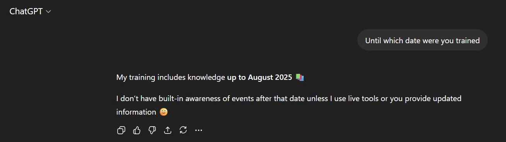
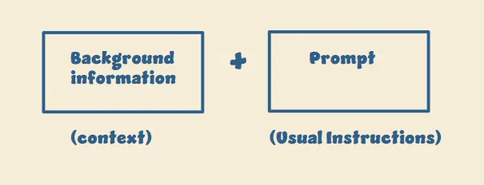
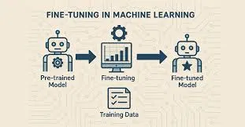
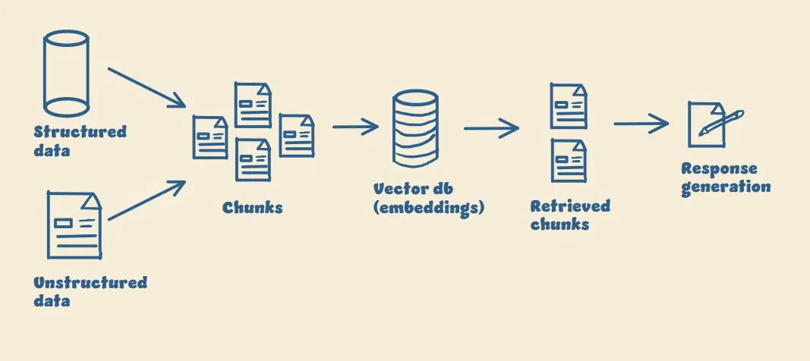

# LLM Hallucinations

Hallucination is one of the biggest problems with LLMs today. These notes cover why it happens and three practical ways to deal with it.

## Why LLMs hallucinate

LLMs are trained on large amounts of past data, and they have a training cutoff.

  

When you ask about something beyond what the model knows, it usually doesn't say "I don't know." It generates the most probable answer based on the patterns it learned, and it sounds confident even when the answer is wrong.

This becomes a serious issue when you build real AI products. You're no longer only generating text. You're generating decisions, insights, and user experiences that may be wrong.

## Three ways to deal with it

### 1. Prompting

If the model only needs to answer from a small piece of context, pass that information in the prompt and tell it to answer only from that context.

  

**Limitation:** Context windows have limits. You can't put all your knowledge into the prompt every time.

  

### 2. Fine-tuning

Retrain the model on your domain data so it learns a specific tone, behaviour, or response style. This gives you deeper control over the model.

  

**Limitation:** Whenever your data changes, you may have to retrain. That makes fine-tuning expensive, time-consuming, and hard to keep updated.

### 3. RAG (Retrieval Augmented Generation)

RAG is the most practical option today. Instead of relying only on what the model already knows, you connect it to an external knowledge source, such as your company documents.

When a question comes in:

1. The system retrieves the relevant context.
2. The model generates an answer based on that context.

The model answers from real, up-to-date information instead of guessing.

  

## Hallucinations never reach zero

Even with RAG, if the system fails to retrieve the right context, the model will still try to generate an answer. The goal is to reduce hallucinations, not eliminate them. If you wait for perfect AI, you'll never ship anything.
