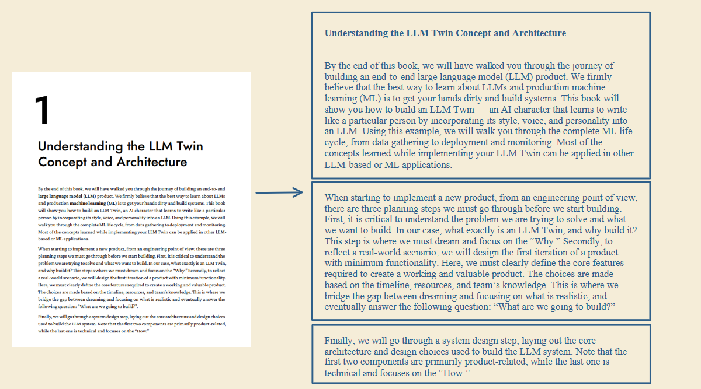
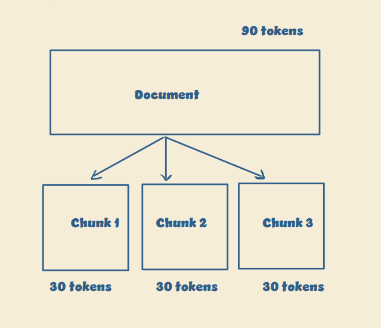
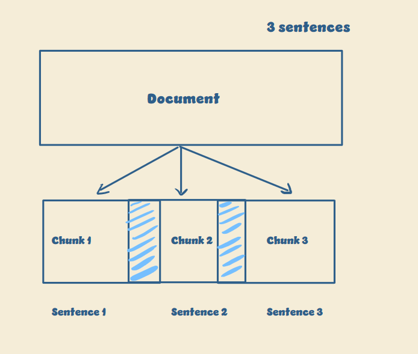
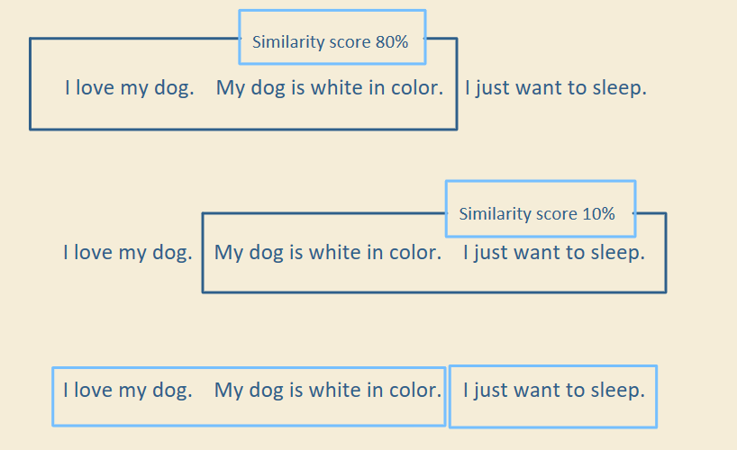
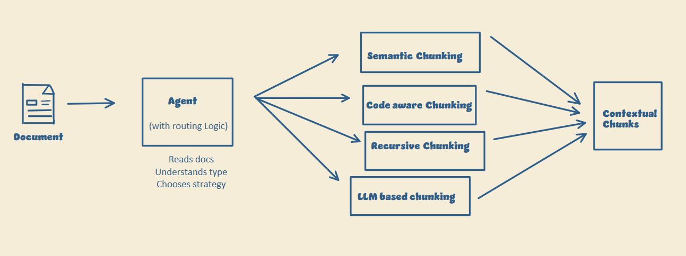

# Chunking Strategies

How you chunk your data is one of the most underrated ways to improve a RAG pipeline.

## Why chunking matters

You can't pass a large document to an LLM in one go. It can hit the context limit. If it doesn't, your token costs go up fast, and the model struggles to process that much information at once.

So you split the document into smaller chunks. The challenge is splitting it without losing important context.

  

Fixed-size and overlap chunking are the usual starting points.

  

  

The two techniques below work better in real-world use cases.

## 1. Semantic chunking

Each chunk should carry a clear, independent meaning.

To get there, you compare how similar sentences are in meaning:

- **High similarity:** The sentences talk about the same thing, so they stay in the same chunk.
- **Low similarity:** The meaning has shifted, so a new chunk starts.

Take these three sentences:

  

The first two sentences score 80% similar, so they go into one chunk. The second and third score 10%, so the third starts a new chunk.

  

Instead of splitting at random points, you group sentences that belong together. The retrieved context is more relevant and more complete.

## 2. Agentic chunking

No single chunking strategy works everywhere. A method that works well for GitHub repos or API docs can fail completely on structured documents.

So instead of forcing one method on everything, you keep several chunking strategies and let the system pick the best one for each document. An agent reads the document, works out its type, and routes it to a strategy. Adapting to the data this way gives the best accuracy in real-world systems.

  

You still have to experiment on your own data. That's how you work out what your routing logic should look like.

## Chunking methods

### Fixed-size chunking

The simplest and most common approach. The document is split into chunks with a fixed number of tokens or characters, and each chunk is stored separately in the vector database.

- **Pros:** Easy to implement, fast preprocessing, works well for quick prototypes.
- **Cons:** Sentences or paragraphs can get cut in the middle, and important context can be lost across chunks.

### Sentence or paragraph chunking

Splits text on natural language boundaries (periods, commas, question marks, paragraph breaks) instead of token length. Complete ideas stay together, so the LLM understands the context more easily.

- **Best for:** Articles, blogs, FAQs, documentation.
- **Cons:** Paragraphs can become too long or inconsistent, which can affect retrieval.

### Recursive chunking

Tries to preserve the document's structure by splitting at multiple levels. It starts with large blocks and keeps splitting until each chunk fits the target token size.

- **Pros:** Maintains document structure and produces more meaningful chunks.

### Semantic chunking

One of the most intelligent chunking strategies. See [Semantic chunking](#1-semantic-chunking) above for how it works.

- **Pros:** Higher retrieval accuracy, better contextual understanding.
- **Cons:** More computationally expensive, needs extra embedding calculations.

### Page-level chunking

In some documents, each page is already a logical unit of information: resumes, invoices, research reports, financial statements. Each page becomes one chunk, which preserves the document's structure and layout.

- **Cons:** Fails when important information spans multiple pages.

### Code-aware chunking

Plain text chunking doesn't work well for software documentation or codebases. Chunks should follow programming structures such as functions, classes, modules, and scopes, with each logical unit as its own chunk. This improves retrieval accuracy for developer tools.

### Hybrid or agentic chunking

Also called LLM-based or adaptive chunking, depending on how it's implemented. An agent decides which chunking strategy to apply based on the document type, combining multiple chunking pipelines into one adaptive architecture. Production-scale AI systems commonly use this approach. See [Agentic chunking](#2-agentic-chunking) above.

## Choosing a strategy

There is no universal best chunking strategy. The right one depends on:

- Document structure
- Document length
- Type of content
- Retrieval requirements

| Content | Strategy |
|---|---|
| Blogs | Sentence chunking |
| Research papers | Semantic chunking |
| Codebases | Code-aware chunking |
| Reports | Page-level chunking |

Experiment with multiple strategies and evaluate the retrieval quality on your own data.
