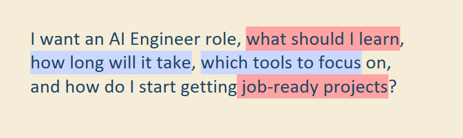
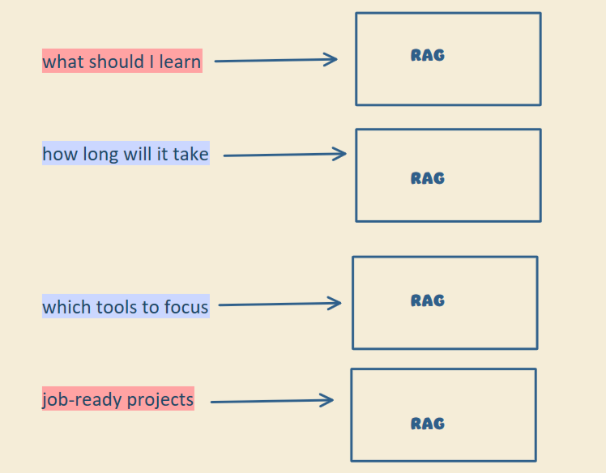
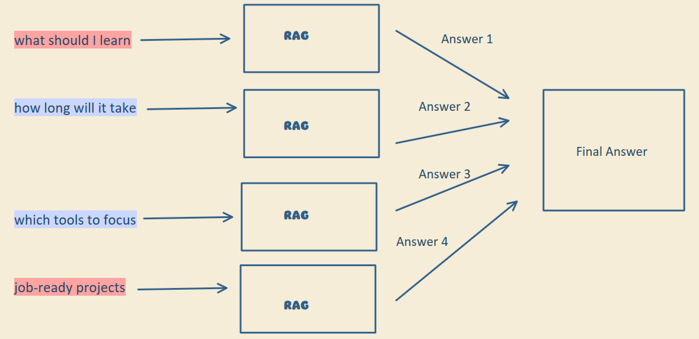
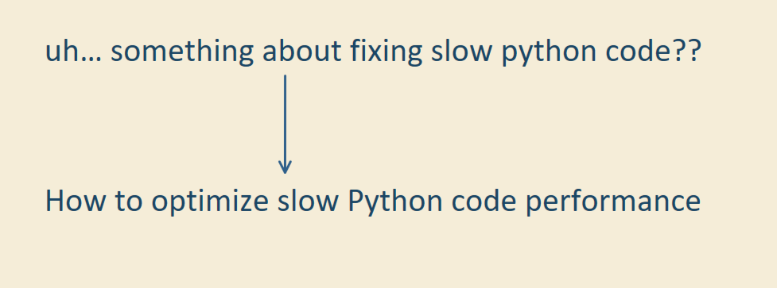
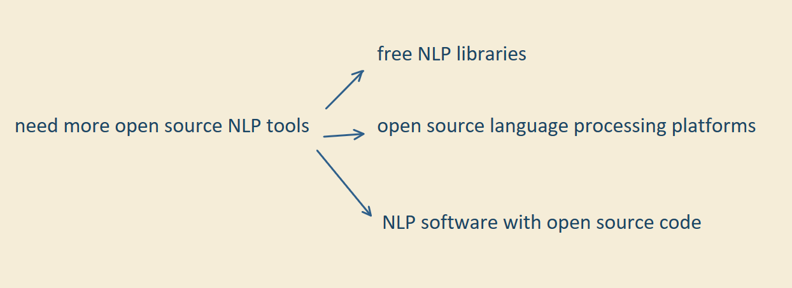

# Query Transformation

Sometimes we don't fully understand what we're asking an AI, and we still expect perfect answers.

In a RAG system, everything starts with the query. If the query is vague or unclear, the whole pipeline carries that confusion forward and you get bad answers. Here are three ways to fix the query before retrieval.

## 1. Query decomposition

Use this when a single query needs information from multiple concepts. Instead of treating it as one big question:

1. Break it into smaller, focused sub-queries.
2. Run each sub-query through retrieval separately, which gives better document matches.
3. Combine the results into one final answer to the original question.

  

  
  

## 2. Query rewriting

Take a messy question and make it clear and precise:

- Remove the parts that don't help and only confuse retrieval.
- Add the keywords that match the right context.

The intent stays the same. It's expressed better, so retrieval finds the right context more easily.

  

## 3. Query expansion

Create multiple related variations of the same query. This helps most when the input is vague, because the variations cover more ground.

For example, "need more open source NLP tools" expands into:

- free NLP libraries
- open source language processing platforms
- NLP software with open source code

  

Don't overdo it. Too many variations can drift from what the user meant, and the system starts pulling irrelevant results. More queries also mean more latency and cost, so expand only as much as you need.

## Beyond RAG

This problem shows up in almost every LLM-based application, not only RAG. When your RAG system gives bad answers, check the query before blaming the pipeline.
