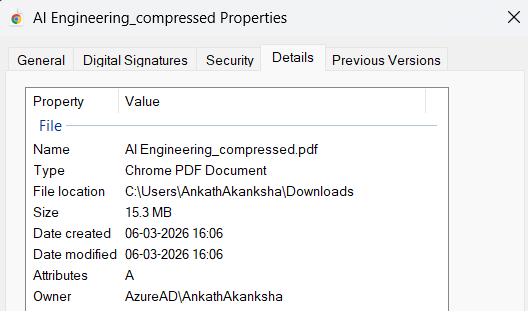
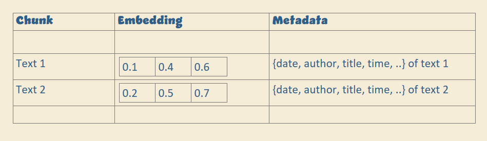
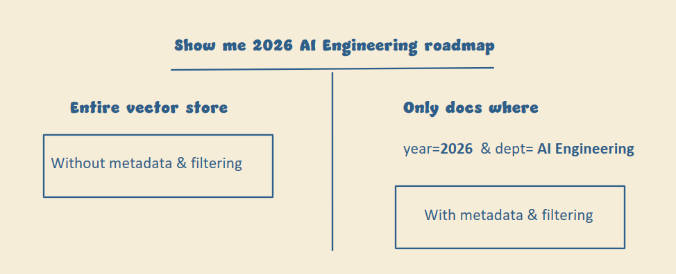

# Metadata Filtering

Say you ask your RAG system for "the latest report" and it returns a similar report, but not the latest one. A metadata and filtering layer fixes this.

## The problem

Your system is good at finding similar text, but it doesn't understand the extra details in your query. Did you mean the latest report, or one from a specific author? Without that information, the system picks whatever looks close enough, and the answer goes wrong.

## How to fix it

### 1. Add metadata during ingestion

When you store your data, don't only chunk and embed it. Attach metadata too.

If the text of a PDF is your data, then details like its date, title, and file name are its metadata.

  

Every chunk now carries context about where it came from and when.

  

### 2. Extract filters from the query

When a user asks for something like "latest report" or "from Riya," an LLM picks out these signals and turns them into filters. Because you stored this information during ingestion, the system knows exactly what to look for instead of searching everything.

### 3. Search within the filtered set

Apply the filters first, then run semantic search only on that smaller, relevant set.

Here's the same query without and with metadata filtering:

  

## Why it's worth it

Once you add this layer, you spend less time debugging, search gets faster, and answers get more accurate.

Not all vector stores support metadata filtering. To implement it properly, pick one that does, such as Pinecone, Weaviate, Qdrant, or pgvector.
