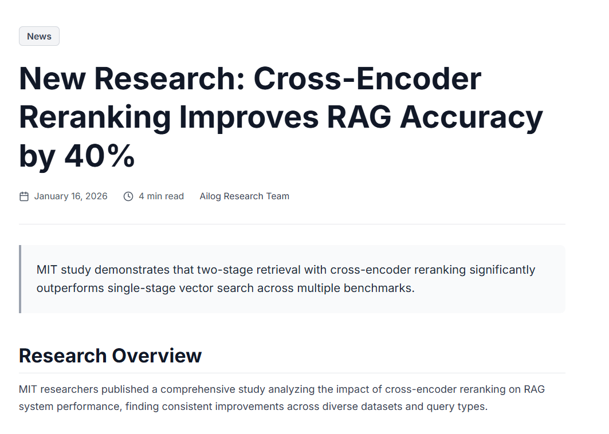
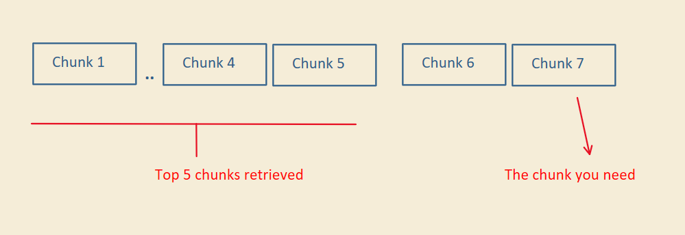
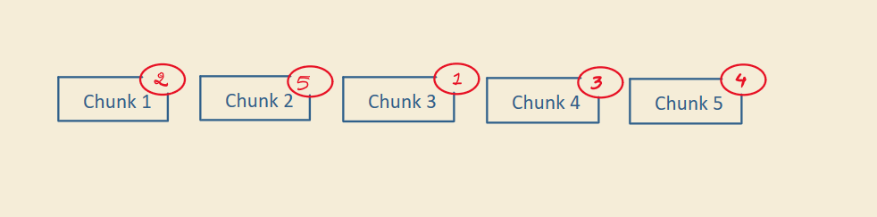
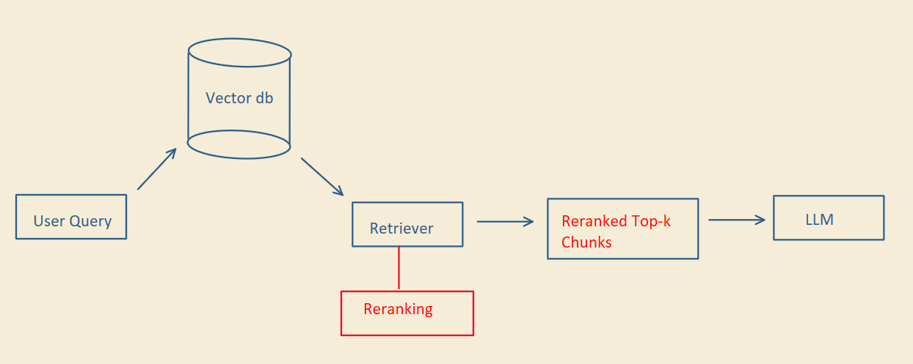
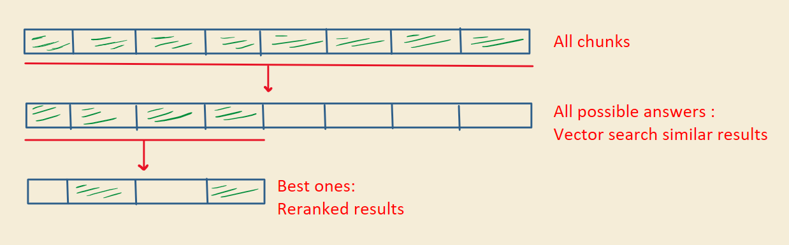

# Reranking

Adding a reranking step to a RAG pipeline can improve accuracy by up to 40%, according to the study below.

  

## The problem

Many RAG systems stop at retrieval. You get a list of chunks where some are relevant and some aren't. You can't send every chunk to the LLM, so you usually pick the top 5.

But the chunk with the actual answer might sit further down the list.

  

Reranking adds one step that changes what reaches the model, so you don't have to trust the top results blindly.

## How it works

### Step 1: Retrieve more

Instead of picking only the top 5, pull more chunks first, like the top 50 or 100 closest to the query. This gathers all the possible answers while filtering out the completely irrelevant ones.

### Step 2: Rerank for relevance

Instead of relying on similarity scores, pass these chunks through a reranker. It looks at each chunk together with the query, scores how useful it is, and reorders the list.

  

Similar doesn't mean useful. Take a query about speeding up slow Python code:

| Chunk | Retrieval | Reranking |
|---|---|---|
| "Python is slower than C++ because…" | Similar | Not helpful |
| "Use caching, multiprocessing…" | Similar | Answers the question |

Retrieval finds chunks that are similar to the query. Reranking checks whether each chunk answers the question.

### Step 3: Send only the best

Take the top few chunks from the reranked list and send only those to the LLM. The model gets the context it needs, not only the closest matches.

  

## Two-stage retrieval

This setup is called a two-stage retrieval architecture:

- **Stage 1:** Quickly fetch the possible answers.
- **Stage 2:** Carefully pick the best ones.

Speed first, then accuracy.

  

## Try it

Tools like [Cohere's Rerank API](https://docs.cohere.com/docs/rerank) make it easy to add reranking.
