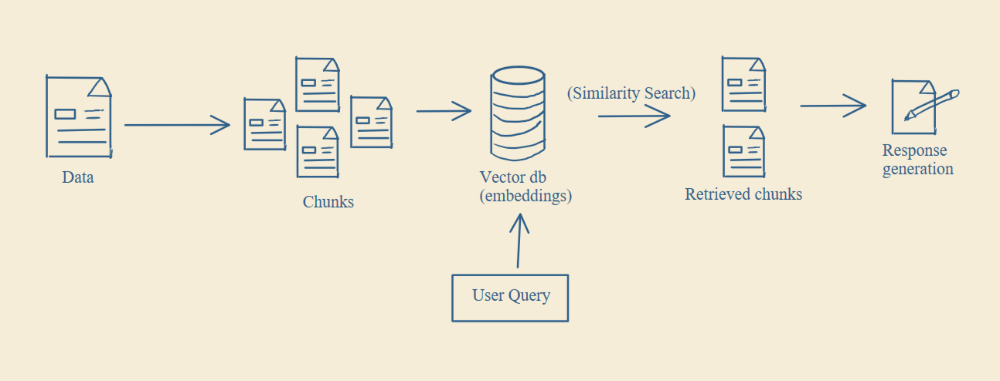
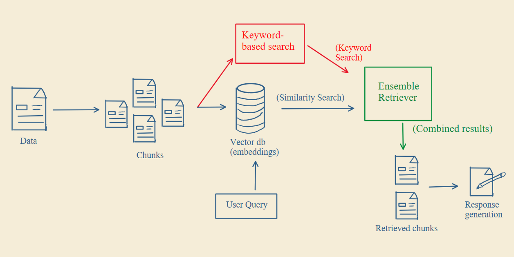

# Hybrid Search

What hybrid search is, why it matters, and how to add it to your RAG system.

## The problem

A typical RAG system relies on semantic search. You convert your data into embeddings, and when a user asks a question, you search by meaning.

  

Semantic search only understands meaning, so it can miss exact keywords like IDs, code names, or technical terms.

Keyword search has the opposite problem. It only matches exact words, so if the same question is phrased differently, it can miss the context and intent.

| Search | Strength | Weakness |
|---|---|---|
| Semantic | Understands meaning | Misses exact keywords |
| Keyword | Matches exact terms | Doesn't understand meaning |

Hybrid search uses both.

## How to add hybrid search

### Step 1: Run both searches

Run semantic search and keyword search on the same query.

Keyword search looks for exact terms in your data, based on how often those terms appear in each chunk. It captures precise keywords like IDs, names, and technical terms. Semantic search covers meaning and intent. Now you have results from both.

### Step 2: Combine the results

Merge the results from both searches with an ensemble retriever. You assign a weight to each search, which decides how much the system trusts semantic results versus keyword results, and the retriever combines them.

  

The answers are more complete and more reliable. Products like Perplexity, Spotify, and Swiggy use hybrid search.

If your RAG system misses obvious results, add hybrid search.
