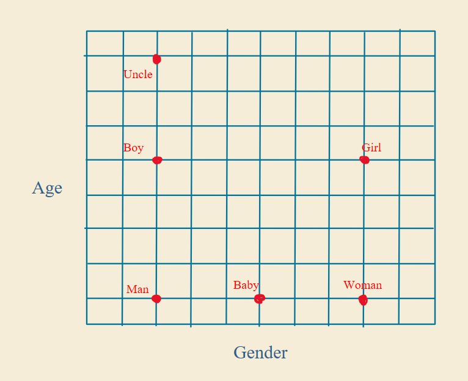
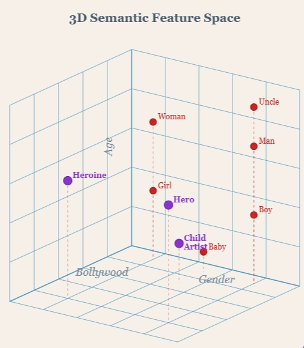
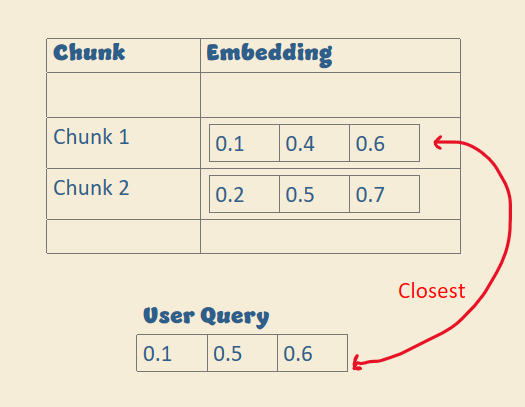
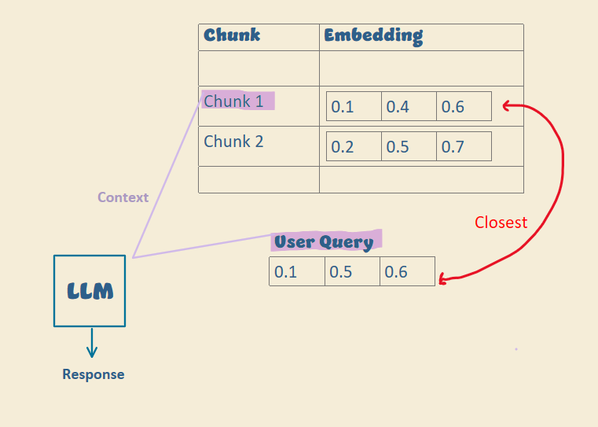
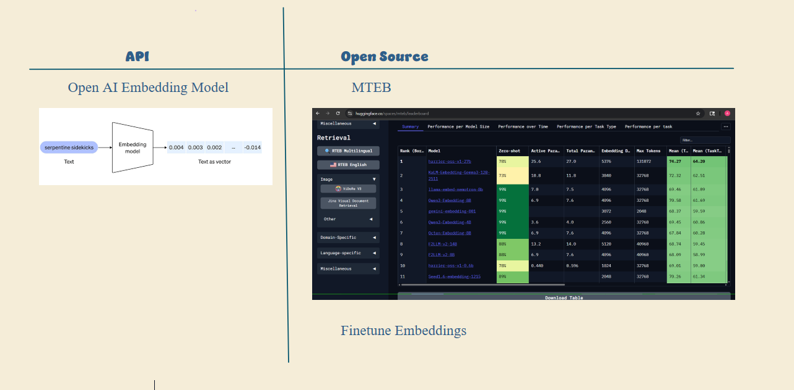

# Embeddings

A no-BS guide to embeddings in three parts: the intuition, how they connect to RAG, and how to choose an embedding model.

## 1. The intuition

Take words like man, woman, boy, and girl. If you place them in a space using features like age and gender, similar words end up close together. Add words like uncle and baby, and they fall into this space based on the same features.

  

Add another feature, like Bollywood, and words like hero, heroine, and child actor get placed accordingly.

  

Each point in this space is a vector: a position in the space. Once words are vectors, you can measure how similar they are by the distance between them.

Models don't understand text directly. They understand numbers. Embeddings convert words into numbers in a way that preserves meaning.

**Embeddings are numerical representations where similar meanings stay close.**

## 2. How embeddings connect to RAG

In RAG, documents are chunked and embedded. The query is embedded too, and the system finds the chunks closest to the query.

  
  

Your LLM only sees the retrieved chunks. It does not see your full document.

So if your embeddings are poor, you retrieve the wrong chunks, and the final answer is wrong no matter how good your model is. Bad embeddings break retrieval without any visible error.

## 3. Choosing an embedding model

The embedding model decides how the meaning of your chunks is captured, so choose it carefully.

  

- **API:** The simplest option is an API like OpenAI's embedding models. You pass in text and get back a list of numbers, where each number is one dimension in the semantic space. Different models have different numbers of dimensions, which affects how well they capture meaning.
- **Open source:** To avoid API cost or latency, use an open-source embedding model. Compare models for your use case on the [MTEB leaderboard](https://huggingface.co/spaces/mteb/leaderboard) on Hugging Face.
- **Fine-tuning:** To improve accuracy, fine-tune embeddings so they understand your domain better than a generic model.
