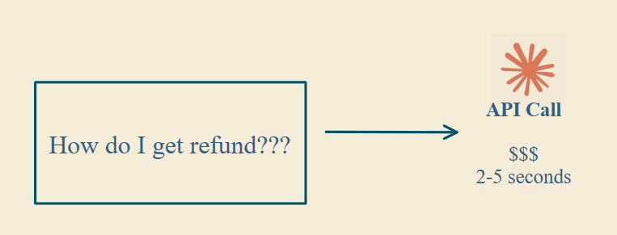
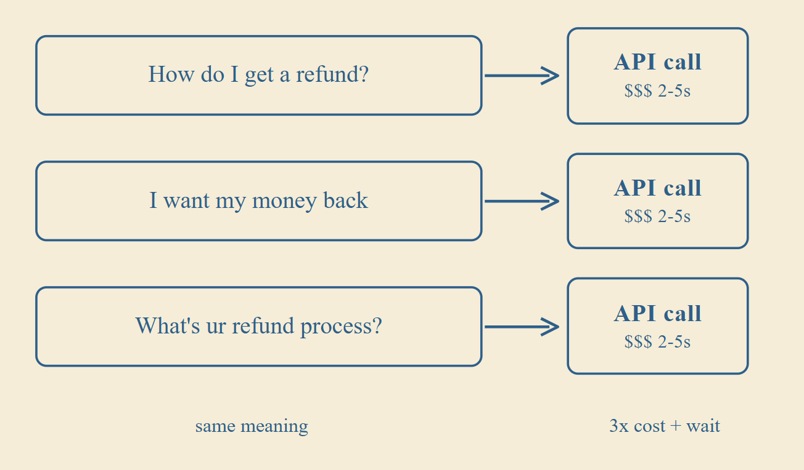
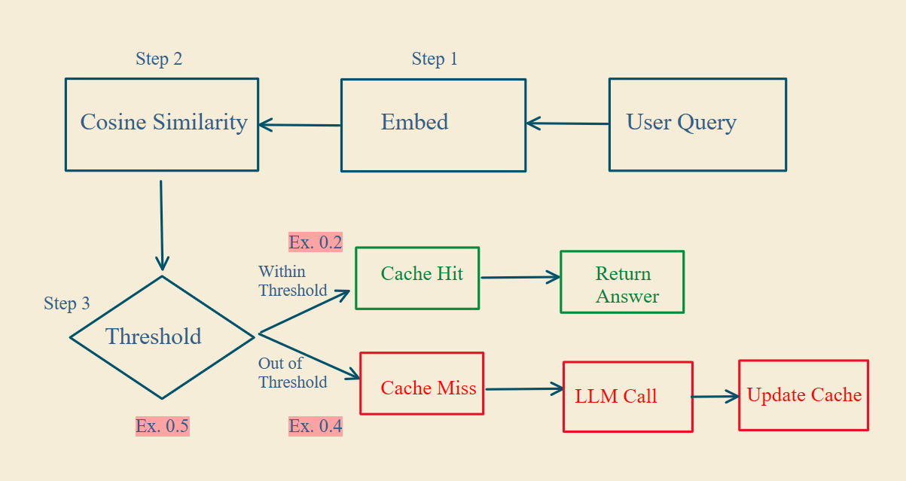
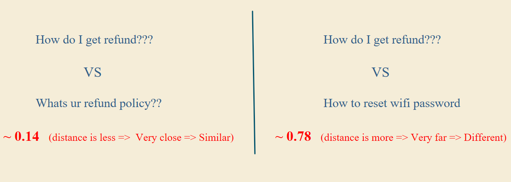
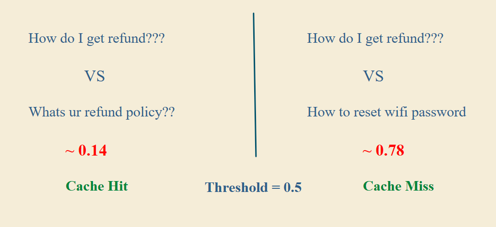

# Semantic Caching

Semantic caching can cut your RAG system's costs by up to 70% and make its responses up to 10x faster.

## The problem

Every LLM call costs money and takes 2 to 5 seconds to respond.

  

In production, around 50% of queries are the same question phrased differently. Each one triggers its own LLM call.

  

Semantic caching fixes this. Instead of answering the same question again and again, you save answers and reuse them for similar queries.

## How it works

  

### Step 1: Embed the query

Convert every query into a vector with an embedding model. "How do I get a refund?" and "I want my money back" end up very close to each other, even though the words are completely different.

### Step 2: Measure similarity

Measure how close the vectors are using cosine distance. A lower score means the queries are closer in meaning.

  

### Step 3: Apply a threshold

The threshold decides whether to return a cached answer or call the LLM.

- **Score below the threshold:** Cache hit. Return the cached answer instantly.
- **Score above the threshold:** Cache miss. Call the LLM and store its answer for future queries.

With a threshold of 0.5, the refund policy question (0.14) is a cache hit, and the wifi password question (0.78) is a cache miss.

  

## Running it in production

1. **Keep the cache up to date.** Your data changes, but your cache doesn't. Without cache updates and versioning, you'll serve outdated answers.
2. **Monitor the metrics,** including how long responses take.
3. **Set up logging and alerts.** You should know how much you're saving and when the cache stops performing. That tells you whether it's worth keeping.

Semantic caching avoids repeated LLM calls, which cuts both cost and latency.
