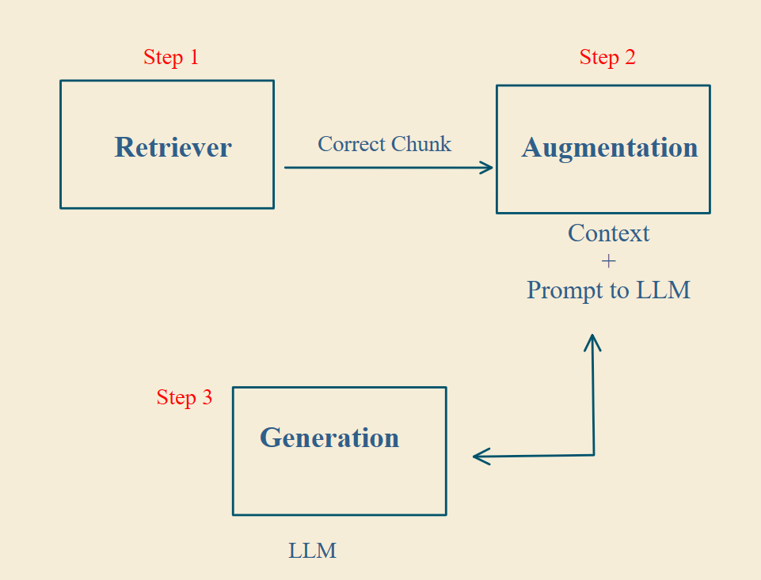
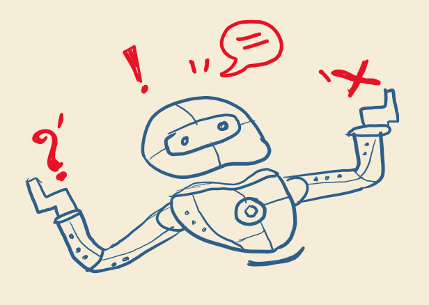
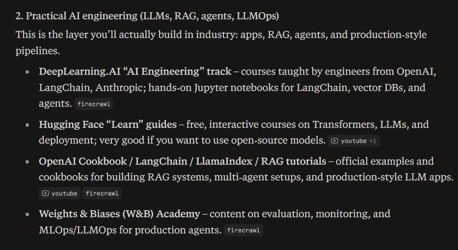
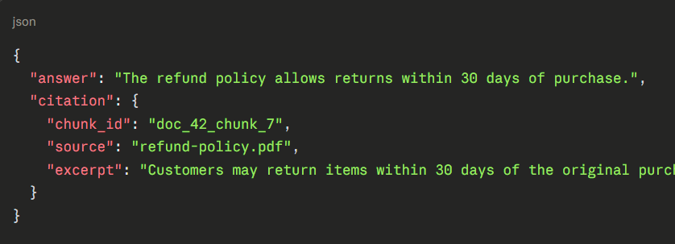
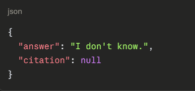

# Grounded Generation

RAG has three steps, but most people only optimize two. That's why their systems still hallucinate.

<p align="center">
  
</p>

If you're building with RAG, you probably obsess over retrieval and handle augmentation well. Generation gets left to the model, which handles it in its own hallucinating way.

## The problem

Sometimes the retriever does its job. You get the right chunk, the context is injected, everything looks perfect, and the model still hallucinates.

<p align="center">
  
</p>

This happens in two ways:

- The model ignores your context and answers from what it already knows.
- The model partly uses your context but mixes it with its own knowledge, giving a confident answer that doesn't match your source.

The answer sounds so fluent that you don't think to check it against your documents.

<p align="center">
  
</p>

You end up with answers that are generic, wrong, or not grounded in your data. Here are two ways to fix this.

## 1. Tell the model exactly how to behave

Give the model explicit instructions in the prompt:

```text
Only use the provided context.
Don't rely on your prior knowledge.
If the answer isn't in the context, say you don't know.
```

Don't suggest. Control it. If the model still struggles, upgrade to a better model.

## 2. Make the model cite its source

Use structured output with citations, so the model shows where each answer came from:

<p align="center">
  
  
</p>

If the model can't point to a source, it should say "I don't know" instead of bluffing. This keeps answers grounded and traceable, so you can trust the system even in high-stakes areas like legal or healthcare.
