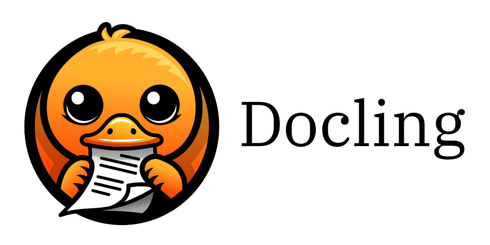
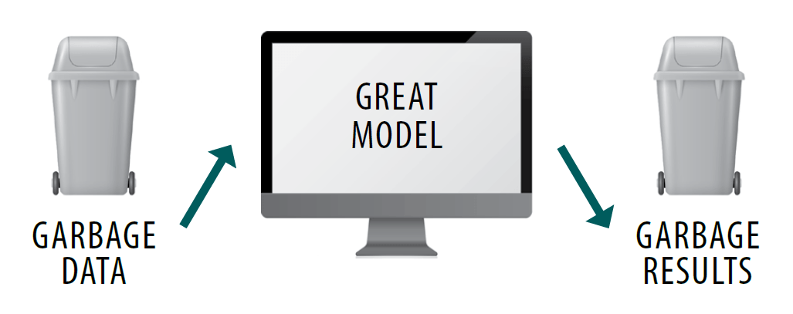
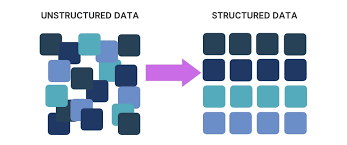
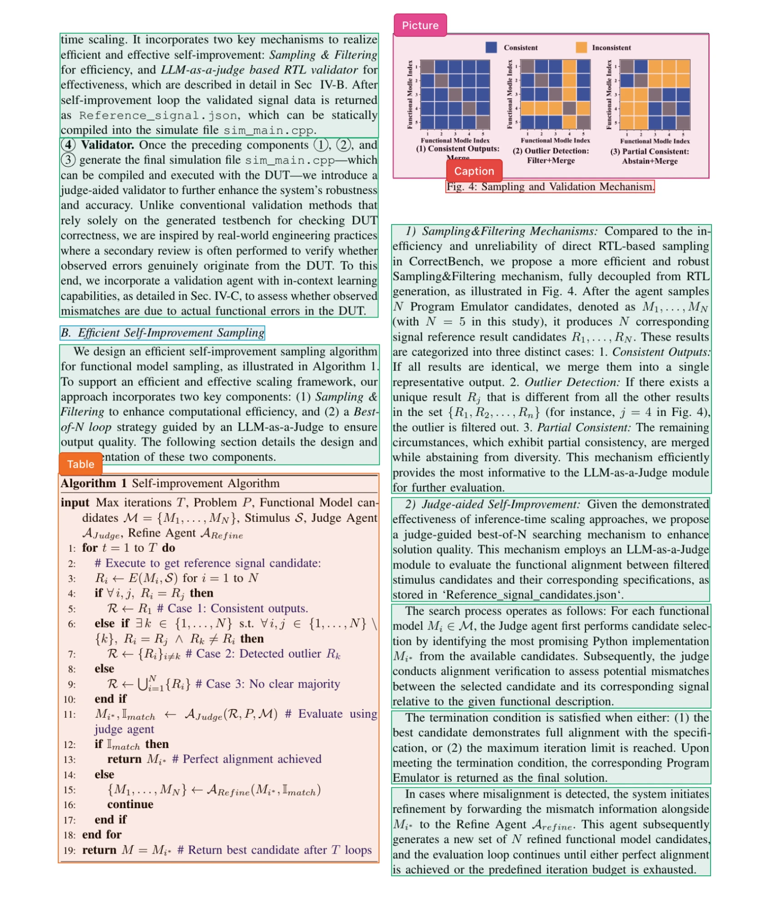
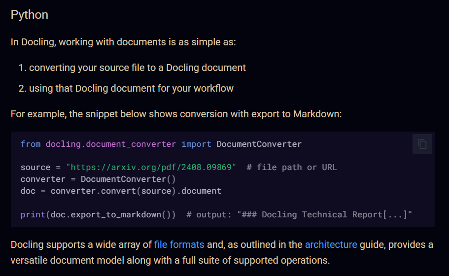
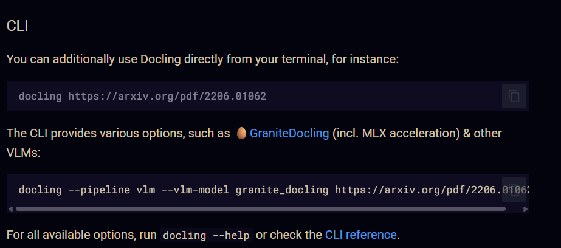
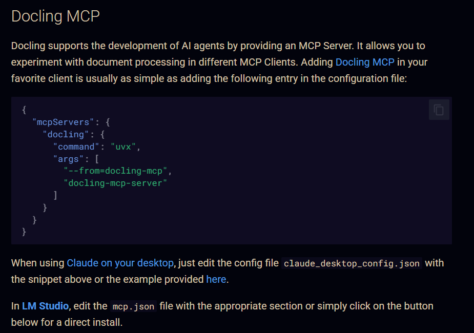

# Document Parsing with Docling

  

Everyone talks about building better RAG. Few people talk about the data problem that comes right before it.

## The problem

Your RAG pipeline needs clean, structured data. Most company data doesn't come that way. It's PDFs, Word files, PowerPoints, scanned images, spreadsheets, and tables: formats your system can't use directly.

Broken input means broken retrieval, no matter how good the rest of your system is.

  

## The fix: Docling

[Docling](https://github.com/docling-project/docling) is an open-source document parser built by IBM. It converts messy documents into clean Markdown, text, or JSON, ready for RAG or AI agents.

  

### 1. It keeps images and tables

Most parsers give up on images and tables. Docling preserves them and adds text descriptions to visuals, so they're searchable like text. Every element also keeps metadata like page numbers, so you can trace exactly where an answer came from.

### 2. It extracts the fields you define

You define what you want from a document, like invoice number, date, or price. Docling returns clean, structured data that matches your schema, ready to feed into your pipeline.

### 3. It chunks by document structure

Instead of splitting text at random points, Docling understands the document's structure. It splits by sections, tables, and captions while keeping context intact. You get more meaningful chunks, better retrieval, and more accurate answers.

  

## Getting started

You can use Docling through its Python API, its CLI, or with prompts through MCP.

**Python API**

  

**CLI**

  

**MCP**

  

