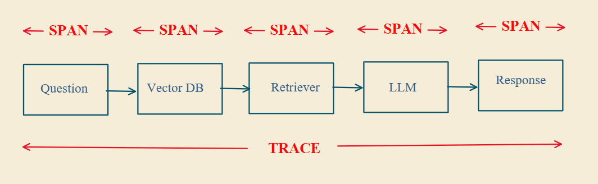
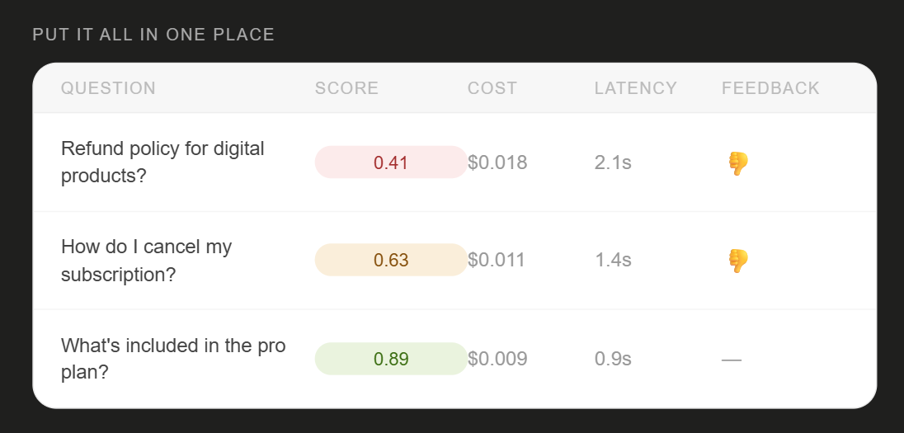
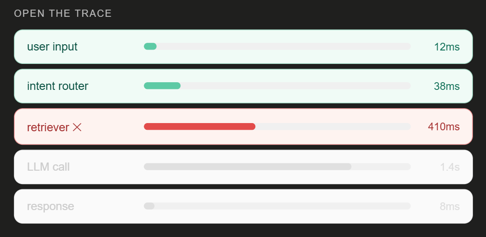
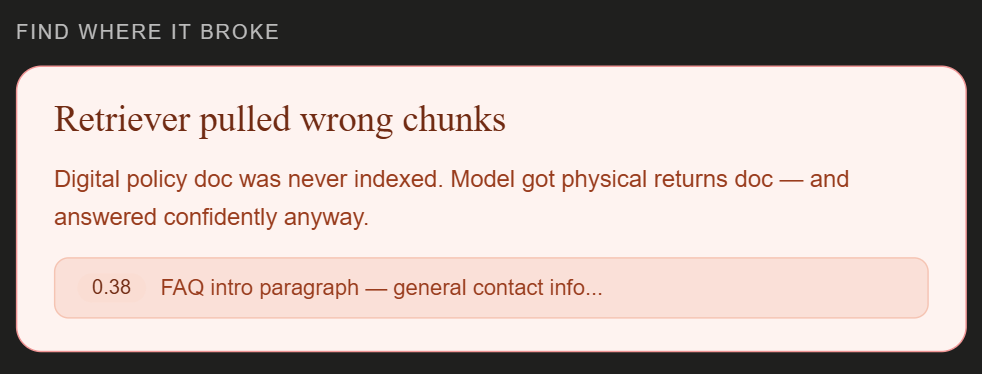
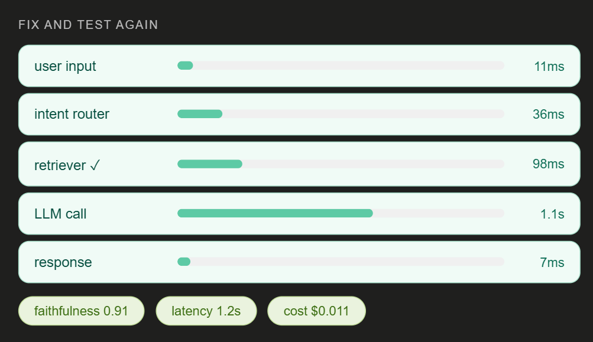

# AI Observability

60% of AI failures come from reasoning errors that nobody notices. There's no crash and no error message, only a bad answer that your user has already seen, and you had no idea.

## Why AI apps need observability

Normal software fails loudly: a page crashes, or an API returns a 500. AI apps fail quietly. The system is up, responses are fast, and the answer is still completely wrong.

There's no signal, and if you don't know why your AI behaved a certain way, you can't fix it. AI observability solves this.

## How it works: a RAG example

### Step 1: Capture the request

When a user asks a question, log everything: the question, the timestamp, the model, the prompt version, and the temperature. Without this, every bug is a mystery.

### Step 2: Trace the pipeline

The question doesn't go straight to the model. It passes through your entire pipeline, and you track every step. The full journey is called a **trace**. Each step inside it is called a **span**.

  

### Step 3: Log the retrieval

Most RAG failures start at retrieval, not at the model: wrong chunks, low similarity scores, or nothing retrieved at all. Then the model makes something up.

Log which documents were fetched, which chunks, and their similarity scores. This step alone explains more failures than any other.

### Step 4: Track the numbers

Track latency, token usage, and cost. Across thousands of requests, you'll see right away when something gets slower, more expensive, or silently breaks after a single prompt change.

### Step 5: Score and flag

Score every response. Did it answer the question? Was it grounded in the retrieved context? Flag the ones that fail, for example:

- The retriever returned nothing, but the model still answered.
- The answer contradicts the source document.
- Cost spiked after a prompt update.

Now you're catching failures before your users do, not only watching.

## Debugging with it

Put it all in one place.

  

1. **Open the trace.**

   

     
   

2. **Find the exact span where it broke.**

   

     
   

3. **Fix whatever the trace points at,** whether that's the retriever, the prompt, or the chunking.
4. **Test again.**

   

     
   

Don't ship blindly. This is how AI teams improve their systems.
