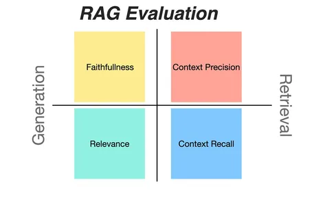
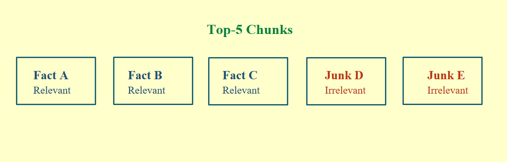
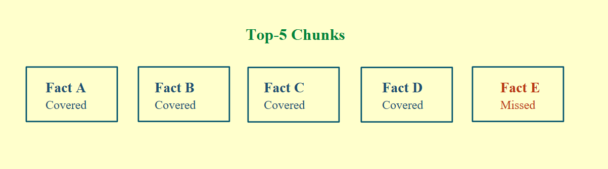

# RAG Evaluation

The hardest part of production RAG isn't building it. It's proving that it works.

RAG evaluation solves this. These four metrics show where your pipeline is breaking and how to fix it. Two measure retrieval, and two measure generation.

  

## 1. Context precision

**Of the chunks you retrieved, how many were useful?**

Say your retriever fetched 5 chunks: 3 were relevant and 2 were junk. Precision catches that.

  

- **High precision:** Relevant results are ranked at the top.
- **Low precision:** Relevant results are ranked lower or missing entirely.
- **Fix:** Rerank the chunks.

## 2. Context recall

**Of everything needed to answer, how much did you retrieve?**

Say 5 facts are needed to answer correctly, but one chunk got missed. Recall catches that.

  

- **High recall:** You got everything needed, even if some irrelevant chunks came along.
- **Low recall:** Important information is missing.
- **Fix:** Increase your top-k.

## 3. Response relevancy

**Did the response answer the question?**

- **High score:** The model answered directly with clear, relevant information.
- **Low score:** The answer is vague, off-topic, or full of unnecessary detail. It answered, just not your question.
- **Fix:** Refine your prompts and add grounding.

## 4. Faithfulness

**How many claims in the response are backed by your documents?**

- **High faithfulness:** The answer came only from your source context.
- **Low faithfulness:** The model gave a confident answer that your sources don't support. That's hallucination.
- **Fix:** Improve retrieval quality and filter out irrelevant context.

## Tools

You don't have to build this from scratch. Frameworks like [RAGAS](https://github.com/explodinggradients/ragas) have built-in modules to evaluate your pipeline on all four metrics.
