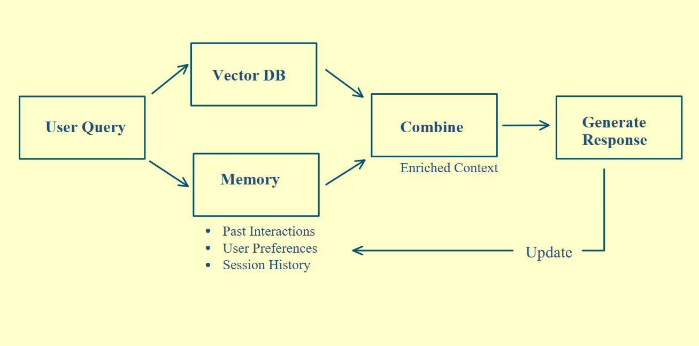
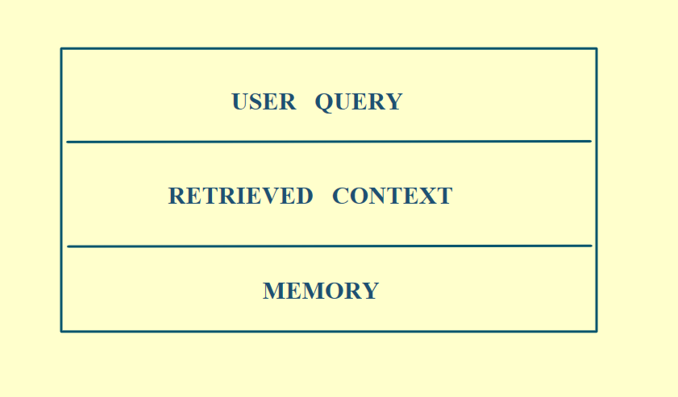

# Memory Layer

A memory layer is what separates a RAG system that retrieves from one that remembers.

## The problem

A standard RAG system retrieves documents well, but it remembers nothing. Every conversation starts from scratch, with no continuity or context, even if the same user has talked to it a hundred times.

The fix is a memory layer.

  

## How it works

### Step 1: Retrieve from two sources

When a user sends a query, two retrievals run in parallel:

- **Document store:** Static knowledge. This is standard RAG retrieval.
- **Memory module:** Past interactions, user preferences, and session history.

### Step 2: Use short-term and long-term memory

The memory module holds two kinds of memory:

| | Short-term memory | Long-term memory |
|---|---|---|
| **Stores** | Recent queries, responses, and intermediate reasoning steps | User preferences, historical decisions, and domain knowledge built over time |
| **Where** | A store like Redis | Indexed by user ID, so the right context comes back for the right person |
| **Lifetime** | Cleared automatically when the session ends | Persistent |

### Step 3: Combine into one context

Both results go into a reasoning module, where they merge into one enriched context. Prompt templates include dedicated placeholders for memory, so the model always knows who it's talking to and what they've already covered.

  

### Step 4: Generate and update memory

The model generates a response using the full context plus everything it knows about this user. After every response, the memory module updates with new interaction details, session summaries, and user feedback, ready for next time. Each response improves the next one.
