# Failure Handling in RAG

A RAG pipeline can break silently in seven ways. Here's how to handle each one.

## 1. Empty retrieval

**Problem:** Retrieval returns no chunks at all. The empty context goes straight to the LLM, and it hallucinates confidently.

  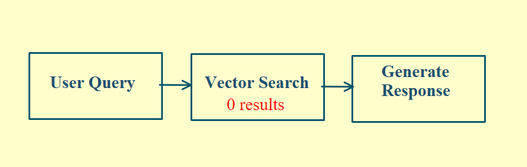

**Fix:** Use a fallback chain:

1. Rewrite the query and retry.
2. If that still returns nothing, fall back to BM25 keyword search.
3. If that also fails, decline gracefully. Don't let the LLM make things up.

  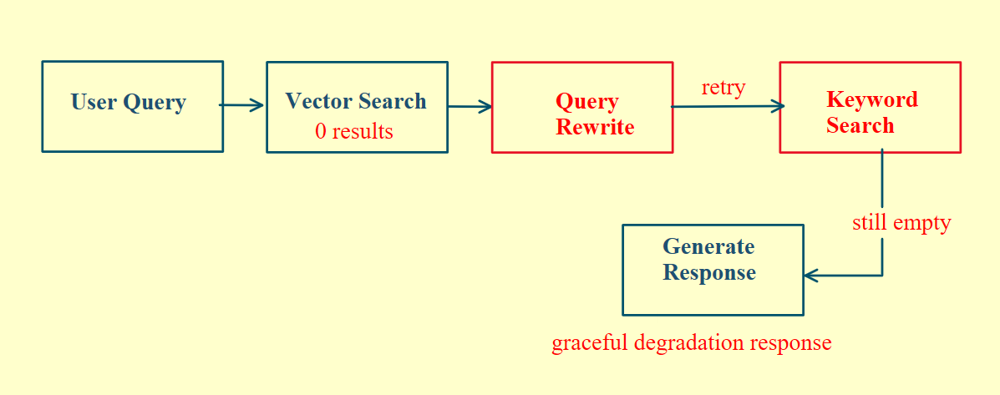

## 2. Low-confidence retrieval

**Problem:** Top-k returns chunks, but they're the wrong ones. If they reach the LLM, the answer goes off-topic. The root cause is that nothing checks how relevant the results are.

  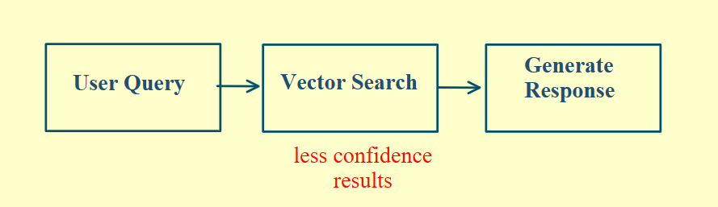

**Fix:** Add a similarity score threshold. If the top result scores below it, don't trust those chunks. Rerank chunks before passing anything to the LLM.

  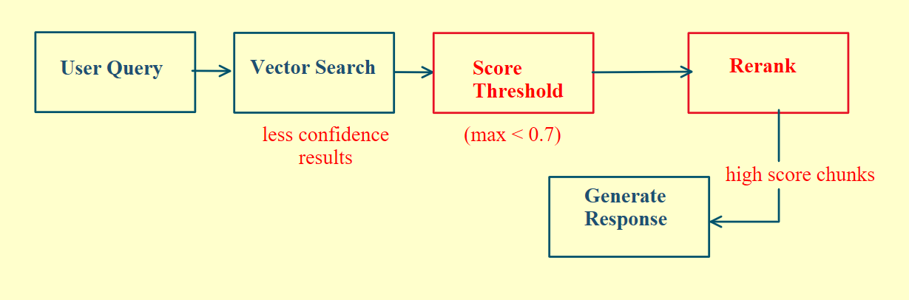

## 3. LLM timeout

**Problem:** The model never responds. The API stalls, no timeout is set, and the request hangs while your user stares at a spinner.

  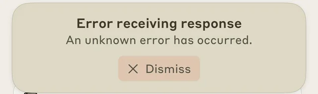

**Fix:** Set a hard timeout. 10 seconds is a good starting point. If it hits, fall back to a smaller, faster model instead of failing completely.

  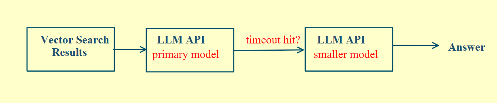

## 4. Rate limit hit

**Problem:** Too many requests, and the API returns a 429. A naive RAG system forwards that error straight to the user.

  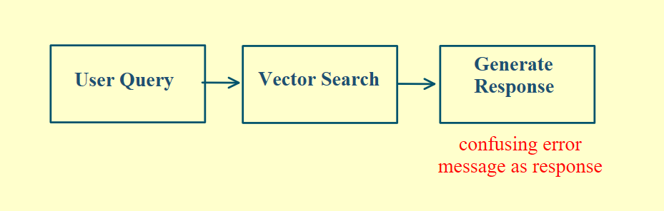
  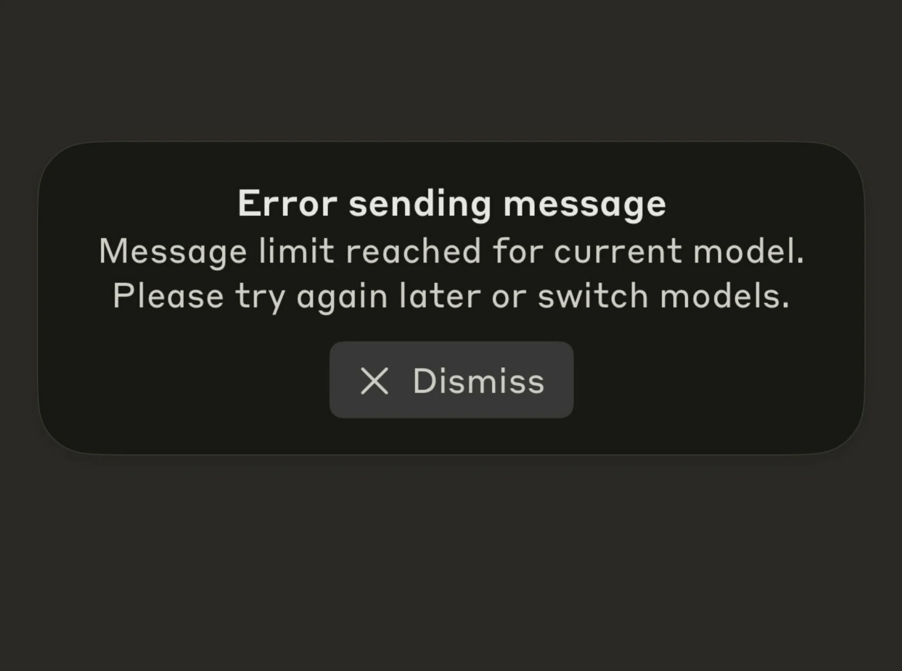

**Fix:** Use exponential backoff: wait 2 seconds, then 4, then 8, with a maximum of 3 retries. Then handle success or failure gracefully.

  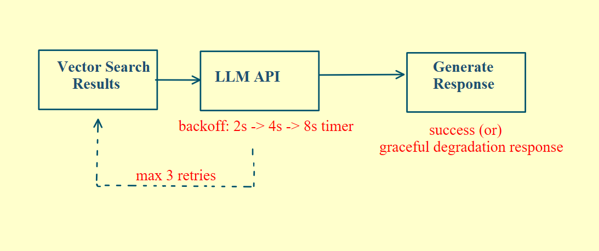

## 5. Context too long

**Problem:** Retrieved chunks, conversation history, and the system prompt add up fast and exceed the model's context limit. The call fails with a 400.

**Fix:** Use adaptive prompting. Estimate the token count before the call. If you're over budget:

1. Trim to your top 3 chunks.
2. Summarize those chunks further.
3. Drop older conversation history.

  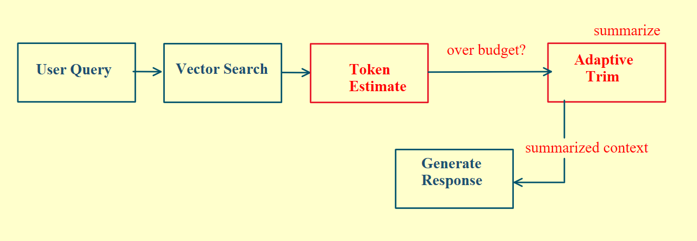

Or route the request to a long-context model.

  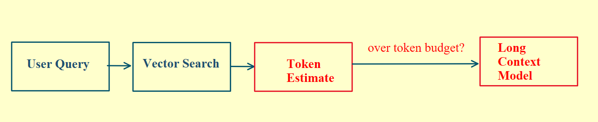

## 6. Cost runaway

**Problem:** A long conversation with large retrieved context means a huge token count on every call. No one notices until the bill arrives at the end of the month.

**Fix:** Estimate the cost before every LLM call and set two thresholds:

- **Yellow line:** Switch to a cheaper model.
- **Red line:** Reject the request.

Track cumulative spend per user, per session, and per day, and set circuit breakers so nothing runs unchecked.

  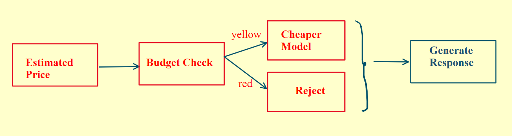

## 7. Low-confidence answer

**Problem:** The LLM generates an answer that isn't grounded in what you retrieved. It sounds confident, it's wrong, and your user believes it.

**Fix:** After generation, score the answer against your retrieved chunks. If the grounding score is below your threshold, don't deliver it directly. Route it to a human review queue, or at least flag it with an explicit uncertainty marker before it reaches the user.

  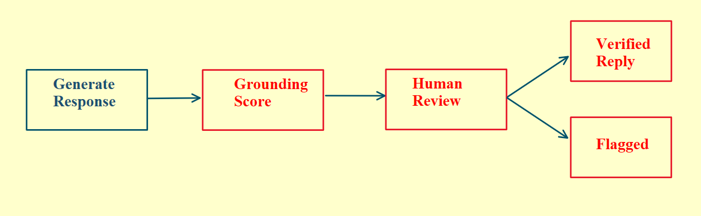

## Where to start

You don't need all seven on day one, but you need to know where the holes are. Failure handling is about what you do when something breaks.
